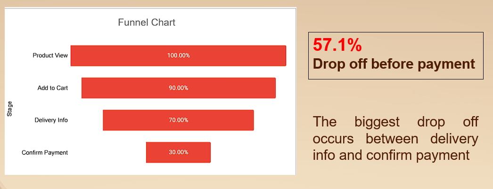

# Seoul Sweets – E-Commerce Customer Journey Analysis

## Project Overview

This project analyzes the customer journey of Seoul Sweets, a Korean bakery business that launched its online ordering service on August 1, 2024.

The analysis focuses on understanding customer behavior throughout the e-commerce purchasing process, identifying where potential customers abandon their shopping journey, and uncovering opportunities to improve the checkout process and overall customer experience.

## Business Problem

Seoul Sweets needs to understand how customers interact with its online store and identify the stages where the highest customer drop-off occurs.

A high drop-off rate during the purchasing process may indicate potential friction points that prevent customers from completing their transactions.

**Key Business Question:**

At which stage of the e-commerce customer journey do customers experience the highest drop-off, and what improvements could help increase purchase completion?

## Project Objectives

- Analyze customer behavior across the e-commerce purchasing journey.
- Evaluate conversion rates at each stage of the customer funnel.
- Identify stages with the highest customer drop-off.
- Develop data-driven recommendations to improve checkout completion and customer experience.

## Analysis Methodology

The analysis focuses on the following stages of the customer journey:

1. **Product View** – Customers view products on the online store.
2. **Add to Cart** – Customers add products to their shopping cart.
3. **Delivery Info** – Customers proceed to provide delivery information.
4. **Confirm Payment** – Customers reach the payment confirmation stage.

### Customer Funnel Analysis

The funnel analysis measures the percentage of customers progressing through each stage, using Product View as the baseline (100%).

| Customer Journey Stage | Conversion Rate |
|---|---:|
| Product View | 100% |
| Add to Cart | 90% |
| Delivery Info | 70% |
| Confirm Payment | 30% |

## Key Findings

### 1. Highest Customer Drop-off

The largest drop-off occurs between **Delivery Info and Confirm Payment**, where 57.1% of customers do not proceed to the next stage.

### 2. Overall Funnel Conversion

Only 30% of customers who viewed a product reached the Confirm Payment stage.

### 3. Customer Journey Performance

The funnel shows a gradual decline in customer progression, with the most significant relative drop-off occurring near the end of the checkout process.

## Business Recommendations

Based on the funnel analysis, several areas could be investigated further:

1. **Review the Delivery Information Process**  
   Evaluate whether the delivery form is clear, simple, and easy to complete.

2. **Evaluate Shipping Costs**  
   Investigate whether unexpected or relatively high shipping costs influence customers' purchasing decisions.

3. **Improve the Payment Experience**  
   Review available payment methods and ensure that the payment confirmation process is clear and convenient.

> Note: These recommendations are potential areas for further investigation. The funnel data identifies where customers drop off but does not establish the underlying reasons.

## Project Limitations

This analysis identifies customer drop-off patterns based on the available funnel data. However, it does not directly determine why customers abandon the purchasing process.

Further analysis using customer feedback, checkout behavior, shipping cost data, or payment failure records would help validate the possible causes.

## Project Visualization

### Customer Funnel Analysis

## Conclusion

The analysis reveals that the most significant customer drop-off occurs between the Delivery Info and Confirm Payment stages, with a relative drop-off rate of 57.1%.

This finding highlights an opportunity for Seoul Sweets to investigate potential checkout and payment friction points. Addressing these issues could help improve the purchasing experience and increase the proportion of customers completing their transactions.

---

**Project Category:** Data Analytics | E-Commerce | Customer Journey Analysis | Sales Funnel Analysis
